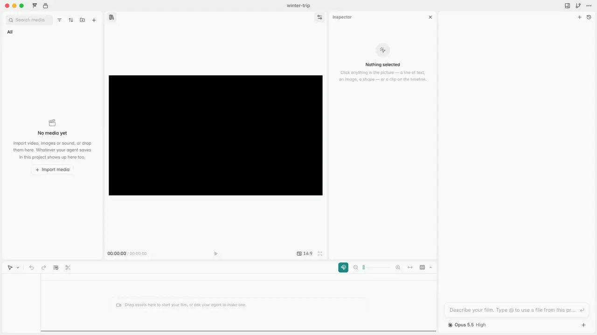

<p align="center">
  <br>
  
  
</p>

<h3 align="center">オープンソースの AI 動画エージェント。</h3>

<p align="center">1 つの HTML ファイル、1 つの関数、1 つの本物のエディタ。</p>

<p align="center"><a href="README.md">English</a> · <a href="README.zh-CN.md">简体中文</a> · <b>日本語</b></p>

## 概要

OpenFilm を使うと、コーディングエージェントが動画を作り、あなたがそれを編集できます。

Codex、Claude Code、またはお好みのコーディングエージェントに動画の制作を頼んでください。エージェントは動画をウェブページとして書き、ブラウザで動くローカルエディタの Studio に、それが形になっていく様子が表示されます。あとは、手作業でも頼んでも、好きなところを変更できます。

- **1 つの HTML ファイル。** `film.html` が、アニメーションするウェブページ、映像、画像、音声をトラック上でつなぎ合わせ、CSS でスタイルを付けます。新しく覚えることはありません。あなたのエージェントはすでにウェブを知っています。
- **1 つの関数。** 各ショットは、`frame(t)` で任意の瞬間を描画するウェブページです。three.js、WebGL、canvas、SVG、CSS、GSAP、動画など、ブラウザが描けるものなら何でも使えます。（Remotion や HyperFrames のような）フレームワークは不要で、1 つの関数で足ります。
- **1 つの本物のエディタ。** ページ内のあらゆる要素を移動、拡大縮小、回転し、テキスト、色、スタイルを変更できます。すべてのクリップを配置、クロップ、スタイル変更し、タイムライン上でトリミングやカットもできます。

<p align="center"><br>
<sub>▶ OpenFilm だけで最初から最後まで作った、<a href="https://www.youtube.com/watch?v=Qea7v6dtNM0">1 分 42 秒のローンチ動画を見る</a>。</sub></p>

## インストール

Node 22.2 以上と ffmpeg が必要です。macOS、Windows、Linux に対応しています（Studio の保存したバージョンには git も必要です）。初回の実行時に、ヘッドレス Chromium（約 100 MB）をダウンロードします。

```sh
npx skills add openfilm/openfilm
```

そのうえで、エージェントに動画を頼みます。

> 私の CLI の 20 秒のローンチ動画を、音楽付きで作って。

エージェントが動画を Studio で開くので、形になっていく様子を見られます。お使いのエージェントにスキルがない場合は、こう伝えてください：「`npx -y openfilm@latest` を実行して、表示された内容に従って。」

または、macOS / Windows 向けのデスクトップアプリを [openfilm.dev](https://openfilm.dev) か [Releases](https://github.com/openfilm/openfilm/releases) からダウンロードしてください。Studio の横に、お使いのエージェント向けのチャットが付いています。ffmpeg とヘッドレスブラウザが同梱されているので、ほかに何もインストールする必要はありません。

動画の制作、編集、レンダリングにアカウントは不要で、OpenFilm の音楽、効果音、音声、ステッカー、トランジション、エフェクト、テンプレートのライブラリは無料で使えます。音声、音楽、画像、動画を生成するには、お使いのサービス（ElevenLabs、OpenAI、Google、OpenRouter、fal など）を Studio の 設定 → サービス で自分のキーで接続するか、そこで OpenFilm にサインインして、自分のキーなしで生成してください。

完成した動画から始めたい場合は、[サンプル](https://github.com/openfilm/examples)のどれかを開きます。

```sh
npx -y openfilm@latest open https://github.com/openfilm/examples/tree/main/one-prompt
```

## コマンド

コマンドはエージェントが実行しますが、あなたも `npx -y openfilm@latest <command>` または `npm i -g openfilm` で実行できます。

```sh
openfilm                          # what a film is, and OpenFilm's own skills: where an agent starts
openfilm open   [folder | url]    # show a film in Studio: a new one, an existing one, one from GitHub, else this one or the last
openfilm look   [what] [t | a-b]  # check the film, a page or a media file: a contact sheet, one frame, or a range
openfilm render [a-b]             # the MP4; --4k, --blur (motion blur), --alpha (.webm / .mov), --loudness=-14
openfilm get    [what]            # media: free from OpenFilm's library first, else made by a connected service
openfilm canvas [apply <steps>]   # the canvas beside the edit: read it, or lay out notes, files and what to make
openfilm skills                   # the skills a film can be made with; `openfilm skill <name>` prints one
openfilm doctor                   # what this computer has for OpenFilm, to paste into an issue
```

`openfilm <command> --help` でコマンドのオプションを一覧できます。`openfilm get` だけを実行すると、作れるもの、ライブラリにあるもの、Studio でサービスを接続する方法が一覧されます。

## Studio

Studio はあなたのマシン上のブラウザで動きます。動画の描画と書き出しに使われるエンジンである Chromium ベースのブラウザ（Chrome、Edge）を使ってください。そうすれば、プレビューがそのまま書き出し結果になります。動画のあらゆる部分を変更できます。画面内のテキストやレイヤー、タイムライン上のクリップ、その位置、見た目、音量、速度、そして字幕です。編集内容は動画のファイルに保存されるので、エージェントはそれを見て保持しますし、名前を付けたバージョンを保存して戻ることもできます。書き出せるのは、動画、GIF、音声やそのステム、字幕、静止画、スライド、透明な動画、そして Final Cut Pro、Premiere Pro、DaVinci Resolve 向けのタイムラインそのものです。

編集の横にはキャンバスがあります（⌘E で切り替えます）。あなたとエージェントがメモ、画像、クリップ、ナレーション、音楽、効果音を並べ、互いにつなぎ、サービスでそれぞれを作り、作ったものを順にタイムラインへ送るボードです。1 つのプロジェクトに複数持てて、それぞれ絵コンテとしても表示できます。素材のドロワーにあるライブラリには、映像、音声、効果音、音楽、テキスト、ステッカー、フィルター、エフェクト、トランジション、テンプレート、そしてスキルが入っています。

デスクトップアプリ（[apps/desktop](apps/desktop)）は、Studio の横にチャットが付いたもので、Claude Code、Codex、その他のエージェント、またはあなた自身のキーで動く独自のエージェント向けです。

## スキル

動画の作り方は、ツールではなくスキルに入っています。`openfilm` が表示するのは 1 ページだけです。動画とは何か、そして OpenFilm 自身のスキルで、残りはそこにあります。`edit`（プロジェクト、film.html、ページ、およびその確認）、`media`（ライブラリとサービス）、`canvas` です。エージェントは、タスクに必要なものを `openfilm skill <name>` で読みます。

それ以外のスキルはすべて、ある種類の動画の作り方で、フルネームの `owner/name` で知られています。Studio のライブラリには、OpenFilm のものとコミュニティのものが 見つける の下に並び、[openfilm/skills](https://github.com/openfilm/skills) から取得されます。そこにはスキルの書き方も載っています。そこからインストールするか、インストールせずに会話の中で試すか、リンクやフォルダーから自分のものを追加できます（`openfilm skill add <link>`）。インストールしたスキルは、すべてのエージェントに提示されます。

## 仕組み

動画は `film.html` を含むフォルダーで、クリップをつなぎ合わせたトラックでできています。

```html
<meta name="viewport" content="width=1920, height=1080">
<style>
  .card { object-fit: cover; border-radius: 24px; }
</style>
<section>
  <iframe src="title.html#t=0,4"></iframe>
</section>
<section>
  <video src="assets/footage.mp4#t=12,18" at="4" speed="0.5" class="card" style="left: 160px; top: 90px; width: 1600px; height: 700px"></video>
</section>
<section>
  <audio src="assets/music.mp3" volume="0.6"></audio>
</section>
```

各 `<section>` は 1 本のトラックで、タイムラインに表示される順に並びます（最初のものが一番上）。クリップは要素で、ページ、動画、静止画、音声のいずれかです。ファイルのどの部分を再生するかはメディアフラグメント（`#t=12,18`）で、開始位置は `at`、配置はスタイルの `left`、`top`、`width`、`height`、見た目は CSS で決まります。すべての音声はそれぞれが独立したクリップです。`overrides` にはページ内の要素に対するあなたの変更が入り、エージェントは編集するときもそれを保持します。

ページとは、自分自身の任意の瞬間を描画するウェブページであり、契約はそれがすべてです。

```html
<script type="module">
window.film = {
  frame(t) { /* draw the complete picture at t seconds, with anything */ },
  duration: 4,               // optional: its own length, in seconds
  ready: loadFonts(),        // optional: a Promise for fonts, images, models, data
  width: 480, height: 320,   // optional: a page that is only a part of the picture
};
</script>
```

**唯一のルール：** それまでに何が描かれていたかにかかわらず、同じ `t` は必ず同じ絵を描きます。フレームは、順不同で、並列に、そして（モーションブラーのために）フレームの合間にも要求されるので、このルールを守るページは、どんなサイズでも、どんなマシンでも、同じようにレンダリングされます。絵を作るそれ以外のもの（Python、Blender、動画モデル）は、動画または画像として取り込まれます。

OpenFilm が力を注ぐのは、モデルが失敗しがちなところ、つまり動画の確認です。`look` はコンタクトシートのすべてのフレームを、順序を変えて 2 回描画し、変わったものを名指しします。あわせて、ページのエラー、読み込みに失敗したフォント、見つからない音声ファイル、フレームで切れたテキストも報告します。

[MANUAL.md](packages/openfilm/MANUAL.md) は `openfilm` が表示するページで、[packages/openfilm/manual](packages/openfilm/manual) には OpenFilm 自身のスキルがあります。[SPEC.md](packages/openfilm/SPEC.md) は、プレーヤー、レンダラー、エディタを作る人向けです。

## ソースから

Node 22.18 以上、pnpm 9（`corepack enable` でこのリポジトリが指定するバージョンが使えます）、PATH 上の ffmpeg、そして git が必要です。

```sh
git clone https://github.com/openfilm/openfilm && cd openfilm
pnpm install
pnpm dev            # Studio from this checkout, with a sample film, beside an installed OpenFilm
pnpm test
```

コーディングエージェントに `packages/openfilm/.dev/bin/openfilm` を実行するよう伝えると、あなたのチェックアウトを使って、その Studio で動画を作ります。インストール版でもソース版でも、すべての OpenFilm はプロジェクトを同じライブラリに保存します。

`pnpm dev:desktop` はデスクトップアプリをソースから実行し、`pnpm typecheck`、`pnpm build`、`pnpm audit:public` は名前のとおりのことをします。
各パッケージの詳細は [CONTRIBUTING.md](CONTRIBUTING.md) にあります。

## コミュニティ

質問、アイデア、作った動画は [Discussions](https://github.com/openfilm/openfilm/discussions) へどうぞ。質問は Q&A で、作った動画は Show and tell で共有してください。バグは [Issues](https://github.com/openfilm/openfilm/issues) へ、Studio の 設定 → 開発者 → レポートをコピー（または `npx openfilm doctor`）で得たレポートを添えて報告してください。

## コントリビューション

[CONTRIBUTING.md](CONTRIBUTING.md) を参照してください。セキュリティ上の問題を報告するには、[SECURITY.md](SECURITY.md) を参照してください。

## ライセンス

フォーマット、CLI、Studio、デスクトップアプリは [MIT](LICENSE) です。OpenFilm の名前とロゴは商標です。[TRADEMARK.md](TRADEMARK.md) を参照してください。

## Star History

<a href="https://www.star-history.com/#openfilm/openfilm&Date">
  <picture>
    <source media="(prefers-color-scheme: dark)" srcset="https://api.star-history.com/svg?repos=openfilm/openfilm&type=Date&theme=dark">
    
  </picture>
</a>
