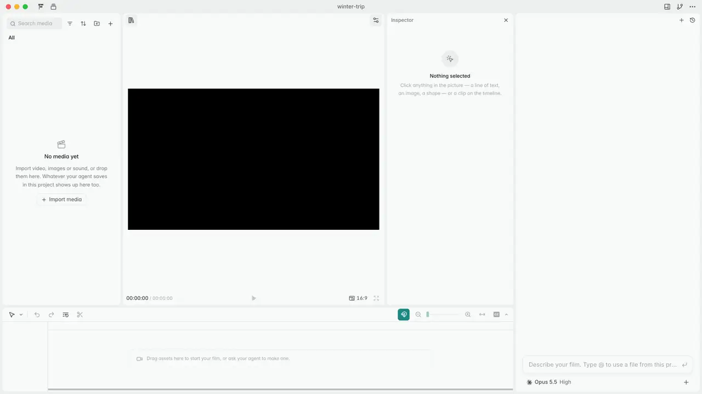

<p align="center">
  
  
</p>
<p align="center">오픈소스 AI 영상 에이전트.</p>
<p align="center">
  <a href="https://www.npmjs.com/package/openfilm"></a>
  <a href="https://github.com/openfilm/openfilm/actions/workflows/ci.yml"></a>
  <a href="LICENSE"></a>
</p>

<p align="center">
  <a href="README.md">English</a> |
  <a href="README.zh-CN.md">简体中文</a> |
  <a href="README.zh-TW.md">繁體中文</a> |
  <a href="README.ko.md">한국어</a> |
  <a href="README.de.md">Deutsch</a> |
  <a href="README.es.md">Español</a> |
  <a href="README.fr.md">Français</a> |
  <a href="README.it.md">Italiano</a> |
  <a href="README.da.md">Dansk</a> |
  <a href="README.ja.md">日本語</a> |
  <a href="README.pl.md">Polski</a> |
  <a href="README.ru.md">Русский</a> |
  <a href="README.bs.md">Bosanski</a> |
  <a href="README.ar.md">العربية</a> |
  <a href="README.no.md">Norsk</a> |
  <a href="README.pt-BR.md">Português (Brasil)</a> |
  <a href="README.th.md">ไทย</a> |
  <a href="README.tr.md">Türkçe</a> |
  <a href="README.uk.md">Українська</a> |
  <a href="README.bn.md">বাংলা</a> |
  <a href="README.el.md">Ελληνικά</a> |
  <a href="README.vi.md">Tiếng Việt</a>
</p>

<p align="center">
  <a href="https://openfilm.dev"></a>
  <a href="https://discord.gg/a462Rs88hF"></a>
  <a href="https://www.youtube.com/@riverisbuilding"></a>
</p>

[](https://openfilm.dev)

---

### 소개

OpenFilm은 어떤 코딩 에이전트든 영상 에이전트로 바꿔 주고, 에이전트가 만든 것은 무엇이든 고칠 수 있는 편집기를 함께 제공합니다.

여러분과 에이전트는 같은 영상을 함께, 실시간으로 작업합니다. 에이전트가 바꾸는 것은 바뀌는 그 순간 여러분 눈에 보이고, 여러분이 바꾸는 것은 에이전트도 봅니다. 작업 대부분은 에이전트가 맡습니다. 여러분은 무엇이든 가리키며 수정을 요청하거나, 직접 고치면 됩니다.

- **영상은 에이전트가 만듭니다.** Claude Code, Codex, 그 밖의 코딩 에이전트, 또는 데스크톱 앱에 내장된 에이전트를 쓰세요. 에이전트가 소재와 음악, 목소리를 찾고, 샷을 하나씩 작성해 이어 붙이는 과정을 그대로 지켜볼 수 있습니다.
- **무엇이든 가리키세요.** 클립 하나, 한 순간, 타임라인의 한 구간, 화면 속 한 지점, 자막 한 줄, 캔버스 위의 카드 한 장. 가리키고 원하는 것을 말하면, 에이전트는 무엇을 말하는지 정확히 압니다.
- **손으로 직접 고치세요.** 샷 안의 어떤 요소든 옮기고, 크기를 바꾸고, 회전하고, 텍스트를 고쳐 쓰고, 색상·글꼴·크기를 바꾸고, 애니메이션을 넣을 수 있습니다. 단어 단위 애니메이션까지 됩니다. 타임라인에서는 클립을 트리밍하고, 나누고, 순서를 바꾸고, 속도·볼륨·페이드를 조절하고, 크롭·색 보정·배경 제거를 하고, 자막과 내레이션을 편집할 수 있습니다. 여러분의 수정은 같은 파일에 저장되고, 에이전트는 그 위에서 이어서 작업합니다.

### 설치

**데스크톱 앱.** [macOS 또는 Windows용으로 다운로드하세요](https://github.com/openfilm/openfilm/releases/latest). 필요한 모든 것이 내장 에이전트까지 함께 들어 있고, 이미 Claude Code나 Codex를 쓰고 있다면 그대로 연결해 쓸 수 있습니다.

**직접 쓰는 코딩 에이전트.** 스킬을 추가한 뒤(Node 22.2+와 ffmpeg 필요), 영상을 만들어 달라고 요청하세요.

```bash
npx skills add openfilm/openfilm
```

> 내 CLI 출시 영상을 음악을 넣어 20초 분량으로 만들어 줘.

### 편집기

편집기마다 같은 영상을 다루는 방식이 다르고, 어느 편집기에서든 여러분과 에이전트가 함께 작업합니다. OpenFilm에는 편집기 네 가지가 들어 있으며, 다양한 사람을 위한 공식 편집기를 더 개발하고 있습니다. 누구나 바로 쓸 수 있을 만큼 쉬운 것부터, 원하는 사람을 위한 전문 작업대까지입니다. 편집기는 커뮤니티의 오픈 표준을 따르므로 누구나 직접 만들어 공유할 수 있습니다.

- **시사**: 영상을 큰 화면으로 봅니다. 한 순간을 클릭하거나, 한 구간을 드래그하거나, 화면 일부에 동그라미를 그리면 에이전트가 무엇을 가리키는지 압니다.
- **편집**: 클립, 텍스트, 자막, 내레이션, 사운드를 모두 다루는 타임라인입니다. 샷 안의 무엇이든 옮기고, 크기를 바꾸고, 스타일을 바꿀 수 있습니다. 영상으로 내보내거나, 타임라인을 그대로 Final Cut Pro, Premiere Pro, DaVinci Resolve로 가져갈 수 있습니다.
- **캔버스**: 노트, 이미지, 클립, 목소리를 나란히 놓고 구상하는 보드입니다. 연결한 서비스로 하나씩 생성한 다음, 순서대로 타임라인에 보냅니다.
- **컬러**: 스코프, 컬러 휠, 커브로 모든 클립을 색 보정합니다. 카메라 로그 촬영본도, `.cube` LUT도 쓸 수 있습니다. 미리 본 그대로 내보내집니다.

네 편집기는 하나의 라이브러리를 함께 씁니다. 여러분의 소재는 폴더로 정리되고, 복사하지 않고 링크로 연결되어 위치를 옮겨도 다시 찾아냅니다. 그 옆에는 OpenFilm의 무료 음악, 효과음, 목소리, 스티커가 있습니다.

### 커뮤니티

커뮤니티는 OpenFilm에 더할 수 있는 모든 것을 위한 오픈 표준이며, 누구나 만들어 기여할 수 있습니다.

- **플러그인**은 새 편집기와 외부 서비스용 커넥터로 OpenFilm 자체를 확장합니다. OpenFilm의 기본 편집기도 플러그인이며, 다른 누구의 플러그인과도 똑같은 방식으로 만들어졌습니다.
- **스킬**은 에이전트에게 특정한 종류의 영상을 만드는 방법을 가르칩니다.
- **에셋**은 음악, 효과음, 트랜지션, 이펙트, 텍스트 스타일, 스티커, 템플릿입니다.
- **예제**는 보고 배우고 리믹스할 수 있는 완성된 프로젝트입니다.

각각은 평범한 폴더 하나입니다. OpenFilm의 커뮤니티 창에서 추가하거나 직접 만드세요. [플러그인 만들기](packages/openfilm/plugins/README.md), [스킬 작성하기](https://github.com/openfilm/community/blob/main/SPEC.md), [에셋 공유하기](https://github.com/openfilm/community/blob/main/assets/CONTRIBUTING.md), 또는 완성한 영상을 예제로 공유한 뒤 [openfilm/community](https://github.com/openfilm/community)에 등록하면 됩니다.

### 작동 방식

영상 하나는 `film.html`이 든 폴더입니다. 그 안에는 클립이 놓인 트랙들이 있고, 스타일은 CSS로 지정합니다.

```html
<meta name="viewport" content="width=1920, height=1080">
<section>
  <iframe src="title.html#t=0,4"
          overrides='[{"at":"h1","text":"Aura Pods","style":{"color":"#7fd4ff"}}]'></iframe>
</section>
<section>
  <video src="assets/footage.mp4#t=12,18" at="4" style="left: 160px; top: 90px; width: 1600px; height: 700px"></video>
</section>
<section>
  <audio src="assets/music.mp3" volume="0.6"></audio>
</section>
```

각 샷은 `frame(t)` 함수 하나로 어느 순간이든 그려 내는 웹 페이지로, 브라우저가 그릴 수 있는 것은 무엇이든(three.js, WebGL, canvas, SVG, CSS, GSAP, 동영상) 쓸 수 있고 같은 `t`에는 늘 같은 그림을 그리기 때문에, 어느 컴퓨터에서나 똑같이 렌더링되고 에이전트가 모든 프레임을 확인할 수 있으며 Remotion이나 HyperFrames 같은 프레임워크도 필요 없습니다.

```js
window.film = {
  frame(t) { /* t초 시점의 완전한 화면을 그린다 */ },
};
```

**여러분의 수정은 그대로 남습니다.** 샷 안의 텍스트, 색상, 위치, 크기처럼 무언가를 손으로 바꾸면, OpenFilm은 이를 페이지 코드가 아니라 클립의 `overrides`에 저장합니다. 에이전트가 페이지를 다시 작성해도 여러분의 수정은 계속 적용됩니다. 전체 형식은 [SPEC.md](packages/openfilm/SPEC.md)에 있습니다.

### 기여하기

소스에서 OpenFilm을 실행하거나 풀 리퀘스트를 보내려면 [CONTRIBUTING.md](CONTRIBUTING.md)를 읽어 주세요. 버그는 설정 → 개발자 → 보고서 복사로 얻은 보고서와 함께 [Issues](https://github.com/openfilm/openfilm/issues)에 올려 주시고, 보안 문제는 [SECURITY.md](SECURITY.md)에 안내된 대로 알려 주세요.

### Star History

<a href="https://www.star-history.com/#openfilm/openfilm&Date">
  <picture>
    <source media="(prefers-color-scheme: dark)" srcset="https://api.star-history.com/svg?repos=openfilm/openfilm&type=Date&theme=dark">
    
  </picture>
</a>
